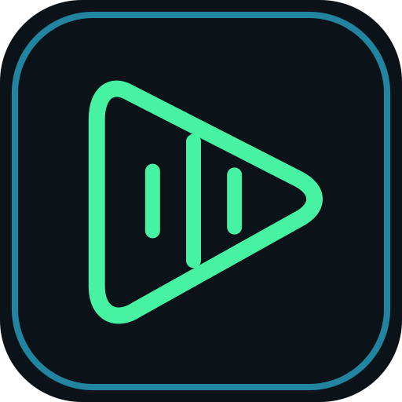

  

<h1 align="center">Guntify</h1>

🎶 Your favorites. Your discoveries. Your kind of radio.

<strong><a href="https://github.com/gpetersons/Guntify/releases/latest/download/Guntify.apk">⬇️ Download Guntify for Android</a></strong> · <a href="https://github.com/gpetersons/Guntify/releases/latest">What's new</a>

Guntify is a music player that gets to know what you love. Find songs, keep your favorites together, and make your own radio stations. 🎧

**Android 8.0 or newer**

## 🚀 Start listening

1. **Download Guntify** using the button above and open the file to install it.
2. **Sign in to Spotify** to bring in your music and playlists.
3. **Pick a song and press Play.** Home gets more personal as you listen.

**Separate installation:** Guntify has its own Android package ID and installs alongside USpot. Local data does not transfer automatically. Keep USpot installed until you have verified what you need.

Next time there's an update, Guntify can let you know. Choose **Install** or **Cancel**, or check anytime in **Settings → Updates**.

## 📸 Take a look around

*Screenshots below were inherited from USpot; some may still show upstream branding.*

<table>
  <tr>
    <td align="center"><strong>🏠 Your Home</strong> Your rotation, recent plays and discoveries.  </td>
    <td align="center"><strong>🔎 Find your next favorite</strong> Search the catalog or browse a mood.  </td>
  </tr>
  <tr>
    <td align="center"><strong>📚 Keep it all together</strong> Playlists, radios, likes and downloads.  </td>
    <td align="center"><strong>🎵 Let it play</strong> Full-screen artwork and your radio controls.  </td>
  </tr>
  <tr>
    <td colspan="2" align="center"><strong>⚙️ Make it yours</strong> Sound, appearance, Smart Downloads and backups.  </td>
  </tr>
</table>

## 💚 A fresh feel, wherever you listen

Move through your music with cleaner pages, smoother transitions and a refreshed player. Pin favorite collections in Library, manage downloads and retry unfinished ones, and find what you want faster with grouped search results. The computer interface gets the same attention, too.

## ✨ Make yourself at home

- **🏠 A Home that learns your taste.** Familiar music to start, more of your favorites as you listen.
- **📌 Keep favorites close.** Pin playlists, albums and Guntify radios in Library.
- **📚 Your music, together.** Liked Songs, playlists, albums, downloads and saved radios.
- **➕ Playlists your way.** Create a playlist, pick songs from your likes and other playlists, or discover something new. Use **Edit** to add and remove songs from playlists you own.
- **⋮ More from every song.** Tap the three dots or hold a song for its menu.
- **📻 Guntify Radio.** Start a station from one song and let the music keep going.
- **🎛️ Radio Mix.** Blend up to five songs into one station. Choose **Stay close**, **Balanced** or **Explore more** to set the mood.
- **🔀 A little surprise.** Smart Shuffle adds relevant discoveries to your playlist listening.
- **👥 Following.** Catch new releases and popular songs from artists you follow.
- **📊 Your listening story.** See favorite songs, artists and recent plays in Stats and History.
- **⬇️ Take favorites offline.** Download music yourself, or turn on Smart Downloads in Settings. It's off until you choose to enable it.
- **🎚️ Your sound.** Equalizer presets and manual controls, plus a device menu for connected speakers and headphones.
- **🌗 Your look.** Light, dark, or follow your phone's theme.
- **🚘 On the road.** Browse your music and recent radios with Android Auto.
- **💾 Keep your memories.** Export and import your local data from Settings.

## 🖥️ Listen at your desk

Open **Settings → Desktop & Browser** on your phone and start desktop mode. Type the address it shows into your computer's browser. Keep your phone and computer on the same trusted Wi-Fi or router.

Your computer plays the music, and your listening adds to the phone app's history. Keep your phone connected while you listen. Stop desktop mode when you're finished. This feature is still being improved.

## 🔒 Your listening stays yours

Guntify retains local listening-history features from USpot. A complete independent security and network traffic audit has **not yet been completed**. This first release should be treated as an early test build.

## 💚 Thank you, Spotui and USpot

**Thank you to [Spotui](https://github.com/Spotui/Spotui), the original authors and contributors, and to [USpot](https://github.com/rare621/USpot) for its Android Auto and music improvements.** Guntify builds on this work with new branding and experimental audio playback fixes.

Thanks also to Meld, Neptune, SpotiFLAC, SimpMusic and the other projects credited in [NOTICE](NOTICE).

Guntify is an independent fork of USpot, originally based on Spotui. It is not affiliated with Spotify or YouTube. Available music and account features depend on those services.

[License](LICENSE) · [Credits](NOTICE) · [Source code](https://github.com/gpetersons/Guntify/releases/latest/download/Guntify-source.zip)
